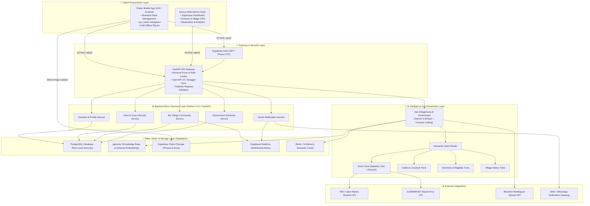
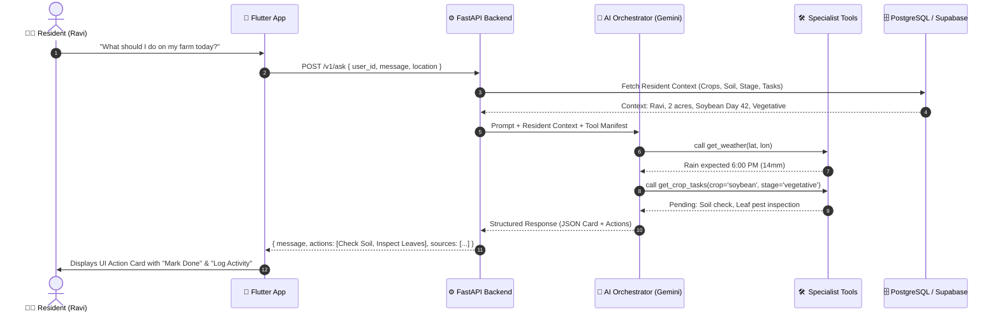
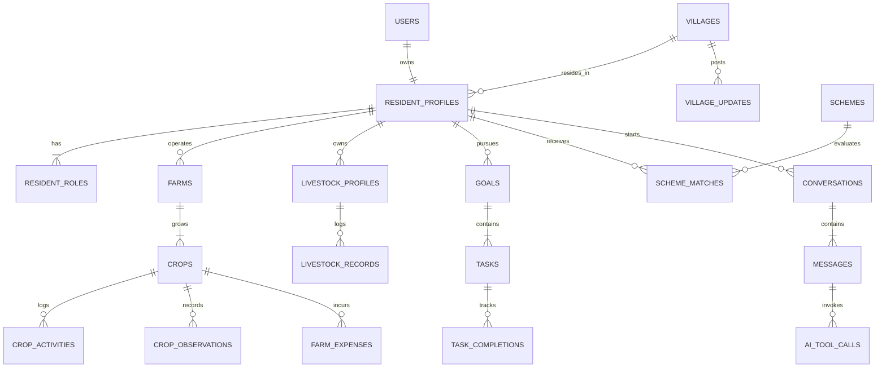
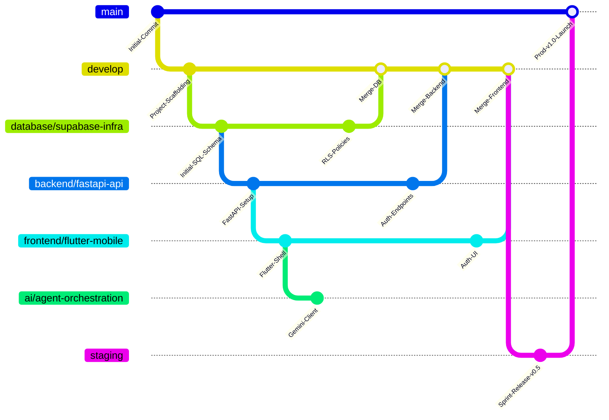
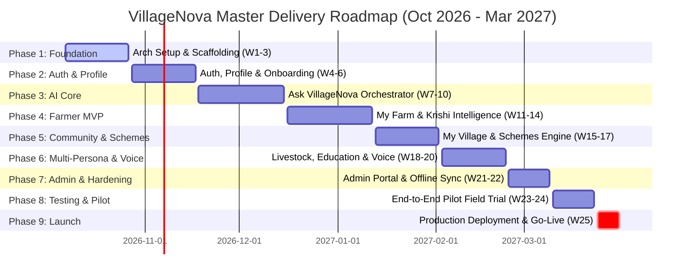

# 🌾 VILLAGENOVA

> **A Personalized Digital Companion & Intelligence Layer for Rural Life**  
> *Target Live Launch: March 2027 | Developed with Google Antigravity & Google Stitch*

---

## 📑 Table of Contents
1. [Product Vision & Core Model](#-1-product-vision--core-model)
2. [Strategic Insights & Architectural Enhancements](#-2-strategic-insights--architectural-enhancements)
3. [System Architecture Blueprint](#-3-system-architecture-blueprint)
4. [Ask VillageNova AI Orchestration Engine](#-4-ask-villagenova-ai-orchestration-engine)
5. [Database Architecture & Entity Relationships](#-5-database-architecture--entity-relationships)
6. [Antigravity Monorepo Directory Structure](#-6-antigravity-monorepo-directory-structure)
7. [Git Branching Strategy & Integration Workflow](#-7-git-branching-strategy--integration-workflow)
8. [Master 25-Week Roadmap & Team Assignments (Oct 2026 – Mar 2027)](#-8-master-25-week-roadmap--team-assignments-oct-2026--mar-2027)
9. [Feature Definition of Done & Quality Standards](#-9-feature-definition-of-done--quality-standards)

---

## 🌟 1. Product Vision & Core Model

Rural residents navigate complex agricultural departments, fragmented government portals, local panchayat notices, and disconnected tools. **VillageNova** consolidates this entire experience into **one intuitive mobile interface** powered by context-aware AI.

```
                    ┌────────────────────────────────────────┐
                    │              VILLAGENOVA               │
                    └───────────────────┬────────────────────┘
                                        │
                         👤 One Resident Profile
                                        │
             ┌──────────────────────────┼──────────────────────────┐
             ▼                          ▼                          ▼
      🏠 MY SPACE               ✨ ASK VILLAGENOVA          🏘️ MY VILLAGE
   (Dynamic per Role)            (Unified Conversational)    (Shared Community)
   • My Farm (Farmer)            Context-Aware Multi-Domain  • Panchayat Notices
   • My Livestock (Cattle)       AI Orchestrator with Tools  • Agriculture News
   • My Education (Student)                                  • Emergency Alerts
   • My Work (Job Seeker)                                    • Local Opportunities
```

### The Resident Experience:
Instead of choosing from 10 different domain chatbots, the resident asks:
> *"What should I do today?"*

VillageNova resolves the resident's context (e.g. Ravi, 2 acres black soil, soybean day 42, rain expected tonight), queries background domain tools, and delivers actionable, bite-sized recommendations with direct action buttons.

---

## 💡 2. Strategic Insights & Architectural Enhancements

To make VillageNova truly resilient and transformative for rural communities, the following 6 core enhancements are built into the architecture:

### 1. Offline-First & Resilient Background Sync
* **Challenge:** Rural areas face frequent 2G/3G connectivity drops and blackouts.
* **Enhancement:** Implement local SQLite/Drift caching on Flutter with an optimistic UI pattern. Activities, expenses, and crop logs are saved instantly to local storage and synced automatically via `WorkManager` when connectivity resumes.

### 2. Multilingual Voice-First UX (Audio In / Audio Out)
* **Challenge:** Diverse literacy levels and local language dialects (Telugu, Hindi, Marathi, Kannada, Tamil, etc.).
* **Enhancement:** Direct audio query integration via Gemini Multimodal Audio and Government of India's **Bhashini** STT/TTS pipeline, allowing users to speak naturally and listen to voice answers in their native tongue.

### 3. Multimodal Crop & Livestock Vision Diagnostics ("Crop Doctor")
* **Challenge:** Farmers struggle to describe pest infections, leaf discolorations, or cattle symptoms with words alone.
* **Enhancement:** Integrated camera capture using Gemini Vision. Farmers snap a leaf photo; the vision engine diagnoses the pathology (e.g., *Yellow Mosaic Virus*, *Fall Armyworm*), provides organic/chemical treatments, and calculates safety intervals.

### 4. Hyperlocal Weather & Agmarknet Mandi Integration
* **Challenge:** Generic city-level forecasts are useless for mandal-level rain decisions.
* **Enhancement:** Ingestion workers pull block-level weather from IMD / Open-Meteo and real-time agricultural market prices from AGMARKNET (Data.gov.in) within a 50 km radius.

### 5. Deterministic Scheme Eligibility Rule Engine
* **Challenge:** Hallucinated scheme qualifications cause farmer frustration and wasted travel time.
* **Enhancement:** Combine vector search (pgvector) for scheme discovery with a deterministic Pydantic rule engine that validates land size, caste/category, and income thresholds before labeling a scheme as *"Eligible"* vs *"Potentially Relevant"*.

### 6. Semantic Response Caching & Rate Limiting
* **Challenge:** Token costs and latency spikes when hundreds of residents ask similar seasonal questions.
* **Enhancement:** A Redis/Postgres semantic cache layers over common queries (e.g., current MSP, weather forecast, pest outbreaks) to deliver sub-200ms responses while conserving Gemini API quota.

---

## 🏗️ 3. System Architecture Blueprint

VillageNova employs a decoupled, production-grade layered architecture optimized for the **Google Antigravity IDE** vibe-coding methodology:



---

## 🤖 4. Ask VillageNova AI Orchestration Engine

The resident speaks to a **single orchestrator**. Specialized agents operate purely as **callable tools**, never as isolated chat bots.

### Interaction Sequence Flow:



---

## 🗄️ 5. Database Architecture & Entity Relationships

The schema is anchored on `resident_profiles` with role-specific tables joined dynamically:



### Key Tables & Policies:
* **`resident_profiles`**: Personal details, language preference, village ID, verification badge.
* **`farms` & `crops`**: Land size, soil type, irrigation source, crop variety, sowing date, stage.
* **`crop_activities` & `crop_observations`**: Action logs (fertilizer, weeding, irrigation) and photo diagnostics.
* **`schemes` & `scheme_matches`**: Scheme requirements, match confidence, match reasoning, tracking state.
* **`village_updates`**: Verified Panchayat/Agriculture bulletins, categorised with target audience tagging.
* **Security**: Supabase Row Level Security (RLS) enabled on all tables; residents can only read/write their own records, with public access strictly limited to verified `village_updates` and `schemes`.

---

## 📂 6. Antigravity Monorepo Directory Structure

The repository follows a clean, decoupled monorepo structure designed for parallel team workflows:

```text
VillageNova/
│
├── .github/
│   └── workflows/
│       ├── mobile-ci.yml               # Flutter static analysis & tests
│       ├── backend-ci.yml              # FastAPI pytest & linting
│       └── db-verify.yml               # Supabase migration validation
│
├── apps/
│   ├── mobile/                         # [Team A] Flutter Mobile App
│   │   ├── lib/
│   │   │   ├── core/                   # Theme, constants, networking (Dio), storage
│   │   │   ├── models/                 # Dart JSON serializable models
│   │   │   ├── providers/              # Riverpod global state providers
│   │   │   ├── routing/                # go_router configuration
│   │   │   ├── features/
│   │   │   │   ├── auth/               # Supabase login & OTP
│   │   │   │   ├── onboarding/         # Progressive resident onboarding
│   │   │   │   ├── home/               # Dynamic home dashboard & action cards
│   │   │   │   ├── ask/                # Ask VillageNova voice & text chat UI
│   │   │   │   ├── space/              # Dynamic "My Space" (My Farm, Education, etc.)
│   │   │   │   ├── village/            # Community notice feed & alerts
│   │   │   │   ├── schemes/            # Scheme discovery, eligibility & tracker
│   │   │   │   └── profile/            # Resident settings & data control
│   │   │   └── widgets/                # Reusable UI components (Google Stitch exported)
│   │   ├── pubspec.yaml
│   │   └── test/
│   │
│   └── admin/                          # [Team A & D] Next.js Web Portal
│       ├── src/
│       │   ├── app/                    # Next.js App Router (Dashboard, Schemes, Village)
│       │   ├── components/             # Admin data tables, charts, forms
│       │   └── lib/                    # Supabase client & API wrappers
│       └── package.json
│
├── backend/                            # [Team B & C] FastAPI Microservice
│   ├── app/
│   │   ├── api/
│   │   │   └── v1/
│   │   │       ├── auth.py             # Auth verification & session hooks
│   │   │       ├── resident.py         # Onboarding & profile management
│   │   │       ├── home.py             # Aggregated home dashboard payload
│   │   │       ├── ask.py              # Ask VillageNova conversational endpoint
│   │   │       ├── farm.py             # Farm, crop & timeline endpoints
│   │   │       ├── village.py          # Village announcements & feeds
│   │   │       ├── schemes.py          # Scheme search & personalized matches
│   │   │       └── notifications.py    # Notification inbox & read status
│   │   ├── core/
│   │   │   ├── config.py               # Pydantic Settings & environment variables
│   │   │   ├── security.py             # JWT & Supabase Auth validator
│   │   │   └── database.py             # SQLAlchemy Async Engine & Session
│   │   ├── models/                     # SQLAlchemy ORM database models
│   │   ├── schemas/                    # Pydantic v2 request & response schemas
│   │   ├── services/                   # Business logic layer
│   │   ├── agents/                     # [Team C] AI Orchestrator & Capabilities
│   │   │   ├── orchestrator.py         # Main Gemini orchestration engine
│   │   │   ├── context_builder.py      # Resident & environmental context assembler
│   │   │   ├── router.py               # Semantic capability router
│   │   │   ├── krishi/                 # Agriculture & crop guidance capability
│   │   │   ├── cattle/                 # Livestock health & vaccine capability
│   │   │   ├── irrigation/             # Smart water & moisture capability
│   │   │   ├── schemes/                # Government scheme matching capability
│   │   │   ├── education/              # Scholarship & learning capability
│   │   │   ├── livelihood/             # Employment & skill training capability
│   │   │   └── village/                # Community news & emergency capability
│   │   ├── tools/                      # Executable tools called by Gemini functions
│   │   └── main.py                     # FastAPI application entrypoint
│   ├── tests/
│   └── requirements.txt
│
├── supabase/                           # [Team D] Database & Infra
│   ├── migrations/                     # Versioned SQL migrations (Alembic / Supabase)
│   ├── seeds/                          # Indian crop stages, schemes & demo village data
│   └── policies/                       # Row Level Security (RLS) definitions
│
├── packages/
│   └── contracts/                      # Shared OpenAPI contracts & API specs
│
├── docs/
│   ├── ARCHITECTURE.md
│   ├── API_SPECIFICATION.md
│   ├── DATABASE_SCHEMA.md
│   └── AI_AGENT_GUIDELINES.md
│
├── .gitignore
└── README.md
```

---

## 🔀 7. Git Branching Strategy & Integration Workflow

To enable seamless parallel development across 4 sub-teams without merge friction, we adopt a structured Git-Flow model:



### Branch Responsibilities:
| Branch Name | Primary Owner | Description & Scope |
|-------------|---------------|---------------------|
| `main` | Tech Lead | **Production Release Branch.** Protected. Deploys live to production servers / stores. Merged only from `staging` after end-to-end audit. |
| `staging` | QA & DevOps | **Pre-Production Staging Branch.** Used for full end-to-end integration testing and pilot village field runs. |
| `develop` | All Teams | **Primary Integration Branch.** Stable working baseline where all team feature branches merge via reviewed PRs. |
| `frontend/flutter-mobile` | **Team A** (Mobile Lead) | Flutter mobile application, Stitch UI screens, Riverpod state, and offline Drift sync. |
| `backend/fastapi-api` | **Team B** (Backend Lead) | FastAPI microservice, database models, Pydantic contracts, and business logic services. |
| `ai/agent-orchestration` | **Team C** (AI Lead) | Gemini orchestrator, function calling tool definitions, prompt engineering, and RAG knowledge search. |
| `database/supabase-infra` | **Team D** (Data/DB Lead) | Supabase schema migrations, RLS security policies, seed datasets, and pgvector embeddings. |
| `integrations/external-apis`| **Team D** (Integrations) | External API connectors (IMD Weather, Agmarknet Mandi, Bhashini speech, SMS gateways). |
| `admin/web-dashboard` | **Team A & D** | Next.js supervisor and community moderation portal. |

### PR Rules of Engagement:
1. **Never commit directly to `main` or `develop`.**
2. Feature branches branch off `develop` (e.g., `feat/farmer-onboarding` off `frontend/flutter-mobile`).
3. Every PR requires:
   * Passing CI tests & lint checks.
   * At least one cross-functional peer review.
   * Adherence to the agreed [API Contract](#-9-feature-definition-of-done--quality-standards).
4. Weekly consolidation: Every Friday, active team branches rebase onto `develop` to test integration early.

---

## 📅 8. Master 25-Week Roadmap & Team Assignments (Oct 2026 – Mar 2027)

*Project Start:* **October 7, 2026**  
*Production Go-Live:* **March 31, 2027**  
*Total Duration:* **25 Sprints / Weeks**



### Detailed Week-by-Week Team Breakdown:

#### 🏛️ PHASE 1: Architecture, Scaffolding & Shared Contracts (Weeks 1–3: Oct 7 – Oct 27, 2026)
* **Week 1 (Oct 7 - Oct 13): Workspace & Contract Blueprint**
  * **Team A (Mobile):** Scaffold Flutter app structure, configure Riverpod, go_router, and design tokens matching Google Stitch exports.
  * **Team B (Backend):** Initialize FastAPI boilerplate, Alembic migrations, Docker setup, and OpenAPI specification scaffold.
  * **Team C (AI):** Establish Gemini API SDK integration testbed, prototype basic function calling schemas.
  * **Team D (Data/DevOps):** Initialize Supabase instance, establish repository branch protections, configure CI/CD pipelines.
* **Week 2 (Oct 14 - Oct 20): Database Schema & Authentication Setup**
  * **Team A (Mobile):** Integrate Supabase Flutter Auth SDK, design splash, language selection, and login screens.
  * **Team B (Backend):** Implement Supabase JWT verification middleware, configure user dependency injection in FastAPI.
  * **Team C (AI):** Design system prompt templates, context-builder schema, and structured JSON output validators.
  * **Team D (Data/DevOps):** Draft baseline PostgreSQL schema migrations (`users`, `resident_profiles`, `villages`), apply basic RLS.
* **Week 3 (Oct 21 - Oct 27): Base Shell & Health Checks Integration**
  * **Team A (Mobile):** Connect mobile login screen to Supabase Auth, verify session persistence and token refresh.
  * **Team B (Backend):** Implement `GET /v1/health` and baseline `GET /v1/me` endpoints.
  * **Team C (AI):** Build mock tool execution harness for local offline testing.
  * **Team D (Data/DevOps):** Seed demo village records (states, districts, sample village master list).

---

#### 👤 PHASE 2: Authentication, Resident Profile & Dynamic Home (Weeks 4–6: Oct 28 – Nov 17, 2026)
* **Week 4 (Oct 28 - Nov 03): Progressive Onboarding Pipeline**
  * **Team A (Mobile):** Build step-by-step onboarding UI (Language → Village location → Multi-role selection: Farmer, Cattle, Student).
  * **Team B (Backend):** Implement `POST /v1/onboarding` and `PATCH /v1/me/roles` with Pydantic validation.
  * **Team C (AI):** Train intent classification for onboarding role preferences.
  * **Team D (Data/DevOps):** Write RLS policies for resident profile creation and role assignment.
* **Week 5 (Nov 04 - Nov 10): Home Dashboard Architecture**
  * **Team A (Mobile):** Implement Home screen shell: greeting header, dynamic role cards, and bottom navigation bar.
  * **Team B (Backend):** Build `GET /v1/home` aggregated endpoint returning greeting, action items, weather summary, and counts.
  * **Team C (AI):** Define dynamic greeting logic and action prioritization rules.
  * **Team D (Data/DevOps):** Setup Redis instance / caching layer for frequently accessed home payloads.
* **Week 6 (Nov 11 - Nov 17): Home & Profile First End-to-End Integration**
  * **Team A (Mobile):** Bind Home screen widgets to Riverpod `homeStateProvider` using Dio network service.
  * **Team B (Backend):** Write unit tests for home payload generation; handle new vs returning user state.
  * **Team C (AI):** Integrate resident context injector for downstream AI invocations.
  * **Team D (Data/DevOps):** Execute first integration merge into `develop`; perform security audit on auth tokens.

---

#### 🧠 PHASE 3: Ask VillageNova AI Orchestrator & Knowledge RAG (Weeks 7–10: Nov 18 – Dec 15, 2026)
* **Week 7 (Nov 18 - Nov 24): Chat UI & Conversational Stream**
  * **Team A (Mobile):** Build "Ask VillageNova" chat screen with quick action chips, message bubbles, and audio record button.
  * **Team B (Backend):** Implement `POST /v1/ask` endpoint supporting both synchronous structured output and streaming.
  * **Team C (AI):** Implement Gemini Orchestrator loop: query intake → context load → tool resolution → answer synthesis.
  * **Team D (Data/DevOps):** Configure `conversations`, `messages`, and `ai_tool_calls` tables with foreign key constraints.
* **Week 8 (Nov 25 - Dec 01): Tool Execution Engine**
  * **Team A (Mobile):** Render structured AI cards (recommendations, action buttons: "Mark Done", "Log Activity").
  * **Team B (Backend):** Build dynamic tool dispatcher mapping Gemini tool calls to internal FastAPI service functions.
  * **Team C (AI):** Author tool specifications: `get_resident_context`, `get_pending_tasks`, `get_weather`.
  * **Team D (Data/DevOps):** Ingest initial Open-Meteo weather API connector.
* **Week 9 (Dec 02 - Dec 08): Knowledge Base & pgvector Integration**
  * **Team A (Mobile):** Display verified source citations and official links under AI answer cards.
  * **Team B (Backend):** Build vector retrieval service (`POST /v1/knowledge/search`) querying pgvector.
  * **Team C (AI):** Implement grounding prompts and hallucination prevention guardrails (strict adherence to official docs).
  * **Team D (Data/DevOps):** Enable `pgvector` extension; chunk and embed initial agriculture university advisories.
* **Week 10 (Dec 09 - Dec 15): Orchestrator Consolidation & Hardening**
  * **Team A (Mobile):** Chat error states, retry logic, and offline message queueing.
  * **Team B (Backend):** Implement rate limiting and conversation truncation for long chat histories.
  * **Team C (AI):** Benchmark response latency; tune Gemini temperature and system instructions.
  * **Team D (Data/DevOps):** Merge Phase 3 feature branches into `develop`; run end-to-end chat test suite.

---

#### 🌾 PHASE 4: Farmer MVP & Krishi Specialist Intelligence (Weeks 11–14: Dec 16 – Jan 12, 2027)
* **Week 11 (Dec 16 - Dec 22): Farmer Onboarding & Farm Profile**
  * **Team A (Mobile):** Build Farmer Onboarding flow (Land size, soil selector with "Don't know" fallback, water source, crop selection).
  * **Team B (Backend):** Implement `POST /v1/farms` and `POST /v1/crops` endpoints with crop lifecycle calculations.
  * **Team C (AI):** Build "Help me choose a crop" conversational sub-flow based on season, soil, and water availability.
  * **Team D (Data/DevOps):** Create tables: `farms`, `crops`, `crop_stages`, `crop_activity_types`.
* **Week 12 (Dec 23 - Dec 29): My Farm Space & Stage Timeline**
  * **Team A (Mobile):** Build "My Farm" dashboard with visual crop stage tracker (Sowing → Vegetative → Flowering → Harvest).
  * **Team B (Backend):** Implement `GET /v1/crops/{id}/progress` calculating stage from sowing date and recorded milestones.
  * **Team C (AI):** Author `get_crop_stage_guidance` tool returning stage-specific alerts (irrigation, fertilizer).
  * **Team D (Data/DevOps):** Seed standardized crop lifecycle matrices for 10 major rural crops (Soybean, Cotton, Paddy, Wheat, etc.).
* **Week 13 (Dec 30 - Jan 05): Activity Logging, Expenses & Observations**
  * **Team A (Mobile):** Build "+ Log Activity", "Add Expense", and "Photo Observation" modal dialogs.
  * **Team B (Backend):** Implement `POST /v1/crops/{id}/activities`, `POST /v1/crops/{id}/observations`, and expense tracking endpoints.
  * **Team C (AI):** Enable camera leaf diagnosis: Gemini Vision prompt extracting disease tags from uploaded observation photos.
  * **Team D (Data/DevOps):** Configure Supabase Storage bucket `crop-observations` with strict image upload policies.
* **Week 14 (Jan 06 - Jan 12): Golden Path Milestone & Krishi Polish**
  * **Team A (Mobile):** Connect Home "Today's Actions" directly to Farm Activity Logging.
  * **Team B (Backend):** Verify that logging an activity updates the progress bar and notifies the AI orchestrator context.
  * **Team C (AI):** Test Golden Path: *"Farmer asks what to do → AI recommends moisture check → Farmer logs activity → Progress updates"*.
  * **Team D (Data/DevOps):** Ingest AGMARKNET Mandi price feed for local district hubs. Merge to `develop`.

---

#### 🏘️ PHASE 5: My Village Community & Government Schemes Engine (Weeks 15–17: Jan 13 – Feb 02, 2027)
* **Week 15 (Jan 13 - Jan 19): My Village Feed & Verified Alerts**
  * **Team A (Mobile):** Build "My Village" feed screen with category filters (Panchayat, Agriculture, Education, Emergency).
  * **Team B (Backend):** Implement `GET /v1/village/updates` with category filtering and emergency push notification triggers.
  * **Team C (AI):** Build AI summarizer for long panchayat government orders into local language bulletins.
  * **Team D (Data/DevOps):** Setup Supabase Realtime channel for instant village announcements; build `village_updates` table.
* **Week 16 (Jan 20 - Jan 26): Government Schemes Discovery & Eligibility Engine**
  * **Team A (Mobile):** Build Schemes tab: "For You" (personalized), "Explore", and "Saved" with requirement checklists.
  * **Team B (Backend):** Implement `GET /v1/schemes/recommended` evaluating resident profile against eligibility criteria.
  * **Team C (AI):** Build Scheme Matcher tool: explains *Why* a scheme is recommended and lists required documents (Aadhaar, Land records).
  * **Team D (Data/DevOps):** Seed database with 25 key Central & State schemes (PM-KISAN, PMFBY, KCC, Rythu Bharosa, Scholarships).
* **Week 17 (Jan 27 - Feb 02): Schemes Tracking & Notification Integration**
  * **Team A (Mobile):** Build Scheme Application Tracker screen and "Set Reminder" interaction.
  * **Team B (Backend):** Implement `POST /v1/schemes/{id}/track` and reminder scheduling service.
  * **Team C (AI):** Enable voice reminders and notification generation for upcoming scheme deadlines.
  * **Team D (Data/DevOps):** Consolidate Phase 5 code into `develop`; conduct integration testing on community feed.

---

#### 🐄 PHASE 6: Multi-Persona Expansion (Cattle, Education) & Multilingual Voice (Weeks 18–20: Feb 03 – Feb 23, 2027)
* **Week 18 (Feb 03 - Feb 09): My Livestock (Cattle Specialist)**
  * **Team A (Mobile):** Build "My Livestock" space (animal card, vaccination schedule, milk yield log).
  * **Team B (Backend):** Implement `POST /v1/livestock` and vaccination reminder schedule generator.
  * **Team C (AI):** Author Cattle Specialist tools: deworming schedules, seasonal feed guidance, veterinary emergency contact.
  * **Team D (Data/DevOps):** Create `livestock_profiles` and `livestock_records` tables.
* **Week 19 (Feb 10 - Feb 16): My Education & Livelihood Spaces**
  * **Team A (Mobile):** Build "My Education" (scholarship discovery, deadline tracker) & "My Work" job cards.
  * **Team B (Backend):** Implement `GET /v1/education/scholarships` and `GET /v1/livelihood/opportunities`.
  * **Team C (AI):** Author Education/Livelihood specialist tools; match student level and skills to opportunities.
  * **Team D (Data/DevOps):** Seed student scholarship guidelines and local skill development programs.
* **Week 20 (Feb 17 - Feb 23): Multilingual Voice & Audio Pipeline**
  * **Team A (Mobile):** Add in-app audio recording and playback widgets to chat interface.
  * **Team B (Backend):** Build audio transcode/streaming pipeline linking mobile audio to Bhashini/Gemini Audio.
  * **Team C (AI):** Configure Telugu, Hindi, and regional speech prompts; verify dialect phonetic accuracy.
  * **Team D (Data/DevOps):** Run performance stress test on audio endpoints. Merge Phase 6 to `develop`.

---

#### 💻 PHASE 7: Web Admin Portal, Offline Cache & Hardening (Weeks 21–22: Feb 24 – Mar 09, 2027)
* **Week 21 (Feb 24 - Mar 02): Next.js Web Admin & Moderation Portal**
  * **Team A (Mobile):** Refactor Flutter local cache with Drift SQLite for seamless offline activity storage.
  * **Team B (Backend):** Build admin authentication and secure moderation endpoints (`POST /v1/admin/village-updates`).
  * **Team C (AI):** Setup toxicity filter and hallucination monitoring metrics for user chat logs.
  * **Team D (Data/DevOps):** Build Next.js supervisor dashboard: resident metrics, active crops, village bulletin publisher.
* **Week 22 (Mar 03 - Mar 09): Background Sync & Low-Bandwidth Optimization**
  * **Team A (Mobile):** Implement automatic background sync with `WorkManager` when device reconnects to Wi-Fi/4G.
  * **Team B (Backend):** Implement idempotent batch ingestion for offline activity logs (`POST /v1/sync/batch`).
  * **Team C (AI):** Configure semantic caching layer to avoid duplicate LLM calls for recurring village questions.
  * **Team D (Data/DevOps):** Optimize database indexes on `farmer_profiles`, `crops`, and `village_updates`. Merge to `develop`.

---

#### 🧪 PHASE 8: End-to-End Testing, Security Audits & Pilot Field Run (Weeks 23–24: Mar 10 – Mar 23, 2027)
* **Week 23 (Mar 10 - Mar 16): Staging Freeze & Comprehensive Integration Testing**
  * **Team A (Mobile):** Execute UI test automation, accessibility (screen reader) checks, and device compatibility tests.
  * **Team B (Backend):** Perform load testing (Locust / k6) simulating 2,000 concurrent resident queries.
  * **Team C (AI):** Run Red-teaming and safety audit: ensure AI never gives dangerous pesticide or medical prescriptions.
  * **Team D (Data/DevOps):** Cut release branch `staging`; run automated migration verification on clean database clone.
* **Week 24 (Mar 17 - Mar 23): Village Pilot Trial & Usability Feedback**
  * **Team A (Mobile):** Conduct closed test with 30 rural test users; refine card touch targets and font legibility.
  * **Team B (Backend):** Fix bugs surfaced during field trial; patch edge-case timeout errors.
  * **Team C (AI):** Fine-tune response brevity based on farmer feedback (keep recommendations under 50 words).
  * **Team D (Data/DevOps):** Complete final penetration testing, RLS audit, and automated database backup verification.

---

#### 🚀 PHASE 9: Production Launch & March 2027 Go-Live (Week 25: Mar 24 – Mar 31, 2027)
* **Week 25 (Mar 24 - Mar 31): Final Launch to Production**
  * **Team A (Mobile):** Generate release Android APK / AAB bundles; submit to Google Play Store.
  * **Team B (Backend):** Deploy production FastAPI cluster on cloud infrastructure; configure autoscaling.
  * **Team C (AI):** Enable production Gemini API production quota and fallback redundancy.
  * **Team D (Data/DevOps):** Merge `staging` into `main`; tag release `v1.0.0-live`. Handover supervisor credentials to village teams.

---

## ✅ 9. Feature Definition of Done & Quality Standards

Every feature across all 25 weeks must satisfy the **Rule of Five** before it is marked complete:

```text
┌────────────────────────────────────────────────────────────────────────┐
│                      THE RULE OF FIVE (DoD)                            │
├────────────────────────────────────────────────────────────────────────┤
│ 1. UI:           Matches Google Stitch design specs, supports dark     │
│                  mode, and is responsive across mobile screen sizes.   │
│ 2. API:          Follows OpenAPI contract, Pydantic validation, and     │
│                  includes unit tests for 200/400/401/500 responses.    │
│ 3. DATABASE:     Has a versioned Alembic migration, indexed foreign     │
│                  keys, and explicit Supabase RLS security policies.    │
│ 4. LOGIC:        Integrates with the AI orchestrator context and        │
│                  reflects immediately in the resident progress engine. │
│ 5. VERIFIED:     Tested end-to-end on both mobile emulator and API.    │
└────────────────────────────────────────────────────────────────────────┘
```

---

## 👥 Team Contact & Roles Directory
* **Product & Architecture Lead:** Project Coordinator
* **Team A (Mobile / UI):** Flutter, Riverpod, Google Stitch integration
* **Team B (Backend / API):** Python 3.12, FastAPI, SQLAlchemy, Alembic
* **Team C (AI Intelligence):** Gemini API, Function Calling, Prompt Engineering, RAG
* **Team D (Data, Infra & Integrations):** Supabase, PostgreSQL, pgvector, External APIs, DevOps

*Built with passion for rural communities worldwide.*
